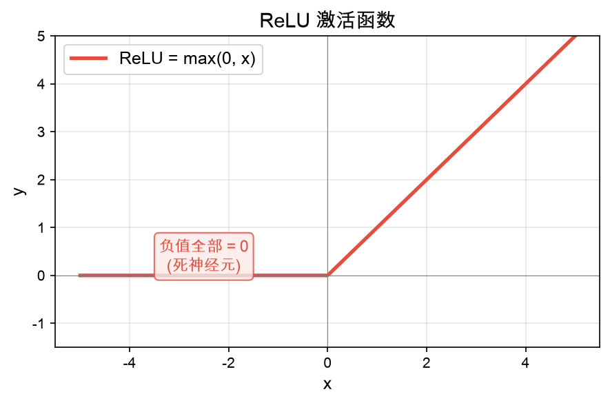
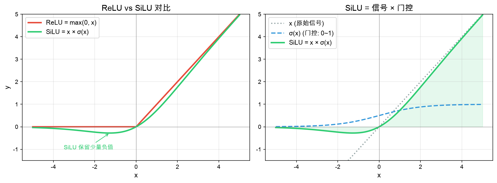
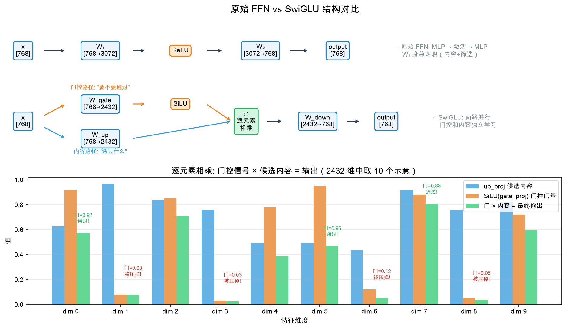

# 05 - FeedForward：让每个 token 独立"思考"

## 为什么需要 FFN？

```
数据流：Attention 输出 → 残差连接 → RMSNorm → 【FeedForward】 → 残差连接
```

#### Attention 能做什么、不能做什么

Attention 的输出 = $\text{softmax}(\frac{QK^T}{\sqrt{d}}) \cdot V$，本质上是 **V 向量的加权平均**。softmax 虽然是非线性的，但它只决定"从谁那里取多少权重"——最终每个 token 的输出是所有 V 的线性组合。

这意味着 Attention 能做的事情是**选择和混合**：从其他 token 那里收集信息。但它不能把收集来的信息**变换**成新的表征——线性组合只能产出原始 V 向量"中间"的值，不能产出 V 空间之外的新模式。

#### FFN 是什么

FFN 就是**两层 MLP 中间夹一个激活函数**，对每个 token 独立做非线性变换（token 之间不交互，交互在 Attention 里已经完成）：

$$\text{FFN}(x) = W_2 \cdot \text{activation}(W_1 \cdot x)$$

如果没有 FFN，多层 Attention 堆叠起来仍然只是在做 V 的线性组合的线性组合——表达能力严重受限。FFN 是每一层中**唯一引入非线性变换能力**的组件。

#### 为什么要先升维再激活

FFN 的结构是 768 → 2432 → 激活 → 768，但升维不是激活函数的前提条件——768 → 768 → 激活 → 768 也能工作，只是效果差。

原因：激活函数对每个维度**独立**做筛选（SiLU 压低某些维度、ReLU 直接置零）。如果在 768 维上做激活，压掉一半就只剩 ~384 个有效维度，信息损失太大。

$W_1$ 的每一行是一个**特征检测器**——768 → 2432 意味着有 2432 个不同的特征检测器。激活函数决定哪些检测器被激活，$W_2$ 把激活后的结果组合回 768 维：

```
768 维输入
   ↓ W₁ (2432 个特征检测器，每个检测输入的一种模式)
2432 维中间层
   ↓ 激活函数 (独立筛选每个检测器：激活 or 抑制)
2432 维 (部分被压低/置零，但基数大，剩余信息仍然丰富)
   ↓ W₂ (把存活的检测器结果组合回 768 维)
768 维输出
```

检测器越多（中间维度越大），能识别和筛选的模式就越多，FFN 的表达能力就越强。

## 从零开始学

### Step 1：原始 FFN（Vaswani 2017）

原始 Transformer 的 FFN 是两层线性投影 + ReLU：

$$\text{FFN}(x) = W_2 \cdot \text{ReLU}(W_1 \cdot x)$$

```
数据流：[B, S, 768] → W₁ → [B, S, 3072] → ReLU → [B, S, 3072] → W₂ → [B, S, 768]
                      升维 4×              激活              降回原维度
```

**问题**：ReLU 把所有负值直接变成 0，太粗暴——大量特征被硬截断丢弃。



### Step 2：SiLU 激活函数——自门控机制

先拆解 SiLU 的公式，它由两部分组成：

$$\text{sigmoid}(x) = \frac{1}{1 + e^{-x}} \qquad \text{（输出范围 0~1，可以理解为"通过率"）}$$

$$\text{SiLU}(x) = x \cdot \text{sigmoid}(x) \qquad \text{（信号 × 通过率 = 自门控）}$$

SiLU 的含义：**x 自己决定自己能通过多少**。sigmoid(x) 把 x 映射到 0~1 之间作为"门控信号"，再乘回 x 本身——x 越大，sigmoid 越接近 1，几乎全部通过；x 越小（负值），sigmoid 越接近 0，大部分被抑制但不完全为零。



对比 ReLU：

$$\text{ReLU}(x) = \max(0, x)$$


ReLU 的问题：x=0 处有硬拐点（梯度不连续），负值全部截断为 0（"死神经元"问题）。
SiLU 平滑过渡，负值区域不完全丢失信息，梯度处处连续。

### Step 3：SwiGLU——加门控机制

#### 从原始 FFN 到 SwiGLU 的变化

原始 FFN 是一条线走到底：

$$\text{FFN}(x) = W_2 \cdot \text{ReLU}(W_1 \cdot x)$$

$W_1$ 身兼两职——既要产出有用的特征内容，又要让激活函数能正确筛选。SwiGLU（Shazeer, 2020）把这一个投影**拆成两路并行**：

$$\text{SwiGLU}(x) = \text{SiLU}(x W_{\text{gate}}) \odot (x W_{\text{up}})$$

$$\text{FFN}_{\text{SwiGLU}}(x) = \text{SwiGLU}(x) \cdot W_{\text{down}}$$

下图上半部分对比了两种结构，下半部分展示了逐元素相乘的具体效果：



#### 逐元素相乘（$\odot$）是什么

两个同样大小的向量，对应位置一个一个乘：

```
gate（门控信号）:  [0.92,  0.08,  0.85,  0.03]    ← SiLU(gate_proj) 产出
up  （候选内容）:  [0.63,  0.97,  0.76,  0.50]    ← up_proj 产出
                     ×      ×      ×      ×
输出:              [0.58,  0.08,  0.65,  0.02]
                    通过!   被压掉  通过!   被压掉
```

gate = 0.92 → 这个维度 92% 通过，内容几乎原样保留
gate = 0.03 → 这个维度只剩 3%，基本被压掉了

#### 三个投影各司其职

- **gate_proj**（$W_{\text{gate}}$）：门控路径——投影后过 SiLU，产出每个维度的"通过程度"
- **up_proj**（$W_{\text{up}}$）：内容路径——投影到高维，产出"候选特征"
- **$\odot$**：门 × 内容 = 筛选后的特征（上图下半部分的绿色柱）
- **down_proj**（$W_{\text{down}}$）：压回原维度

## 维度追踪

```
x: [2, 128, 768]
    ├─ gate_proj → [2, 128, 2432] → SiLU → [2, 128, 2432]  "门"
    ├─ up_proj   → [2, 128, 2432]                            "值"
    ↓
逐元素相乘:     [2, 128, 2432]  门 × 值
    ↓
down_proj:      [2, 128, 768]   降回原维度
```

## intermediate_size 为什么是 2432

SwiGLU 比原始 FFN 多了一个投影（3 个 vs 2 个），参数量多 50%。
为了保持总参数量不变，intermediate_size 取 **8/3 × hidden_size** 而不是 4×。

```python
import math
intermediate_size = math.ceil(768 * math.pi / 64) * 64
# 768 × π ≈ 2413.7 → ceil(2413.7/64) = 38 → 38 × 64 = 2432
# π ≈ 3.14 近似 8/3 ≈ 2.67，稍大一些
# 对齐到 64 倍数是为了 GPU Tensor Core 对齐，矩阵乘法效率更高
```

## 参数量对比

```
SwiGLU (3 个投影):
  gate: 768 × 2432 = 1,867,776
  up:   768 × 2432 = 1,867,776
  down: 2432 × 768 = 1,867,776
  合计: 5,603,328 ≈ 5.6M/层

原始 FFN (2 个投影):
  W1: 768 × 3072 = 2,359,296
  W2: 3072 × 768 = 2,359,296
  合计: 4,718,592 ≈ 4.7M/层

SwiGLU 参数多 ~19%，但门控机制让效果显著更好。
```

## 完整实现

> 📁 追加到 `scratch/model/model_minimind.py`

```python
class FeedForward(nn.Module):
    def __init__(self, hidden_size=768, intermediate_size=2432):
        super().__init__()
        self.gate_proj = nn.Linear(hidden_size, intermediate_size, bias=False)  # Step 3: 门控
        self.up_proj   = nn.Linear(hidden_size, intermediate_size, bias=False)  # Step 3: 候选特征
        self.down_proj = nn.Linear(intermediate_size, hidden_size, bias=False)  # Step 3: 降维

    def forward(self, x):
        return self.down_proj(F.silu(self.gate_proj(x)) * self.up_proj(x))

# 验证
ffn = FeedForward()
x = torch.randn(2, 128, 768)
out = ffn(x)
assert out.shape == x.shape  # [2, 128, 768]

total = sum(p.numel() for p in ffn.parameters())
print(f"FFN params: {total:,}")  # 5,603,328
print("FeedForward verified!")
```

## 对照 MiniMind 源码

| 我们的实现 | MiniMind 源码位置 |
|-----------|-----------------|
| `FeedForward` 类 | `model_minimind.py:136-146` |
| `gate_proj` + `up_proj` + `down_proj` | 完全一致 |
| `F.silu` | `ACT2FN['silu']` |
| 一行 forward | 完全一致 |

## 业界对比

| 特性 | MiniMind (64M) | Qwen2.5-7B | DeepSeek-V2 | LLaMA 3-8B |
|------|---------------|------------|-------------|------------|
| FFN 类型 | SwiGLU | SwiGLU | SwiGLU (MoE内) | SwiGLU |
| intermediate_size | 2432 | 18944 | 12288 | 14336 |
| 倍率 | 3.17× | 5.29× | 2.4× | 3.5× |
| 激活函数 | SiLU | SiLU | SiLU | SiLU |
| bias | 无 | 无 | 无 | 无 |

所有主流大模型都用 SwiGLU 替代了原始的 ReLU FFN，且都去掉了 bias。

## 面试话术

> "FFN 我从原始的两层 ReLU MLP 开始，然后改成 SwiGLU 门控机制。
> 三个投影：gate_proj 过 SiLU 决定'要不要通过'，up_proj 提供'通过什么内容'，
> 两者逐元素相乘做门控，再由 down_proj 降回 768 维。
> 相比原始 FFN 多一个投影但效果显著更好——门控让模型自己学会抑制不重要的特征。
> 为了控制总参数量，中间维度取 8/3 倍而不是 4 倍。
> 我用的是 ceil(768×π/64)×64=2432，对齐 64 方便 GPU Tensor Core。"
