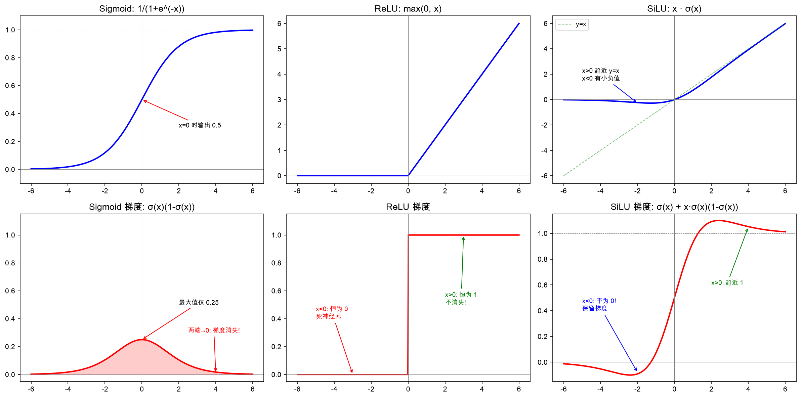

# ML/DL 面试数学基础 -- todo（整体待系统学习）

> 面试中可能考到的数学知识全览。每个知识点给出核心公式 + 直觉解释 + 面试考法。
> 重点标注 ⭐ = 高频考点，🔥 = Transformer/LLM 相关必考。
>
> **学习进度标注**：✅ = 已学过 / 已理解，⬜ = 待学习

---

## 一、线性代数

### 1.1 向量与矩阵基础 ✅

**向量内积（点积）**：

$$
\mathbf{a} \cdot \mathbf{b} = \sum_{i} a_i b_i = \|\mathbf{a}\| \|\mathbf{b}\| \cos\theta
$$

- 衡量两个向量的"方向一致性"
- $\cos \theta = 1$ 完全同向，$0$ 正交，$-1$ 反向
- 🔥 Attention 的 $Q \cdot K$ 就是内积，衡量 query 和 key 的相似度

**矩阵乘法** ⭐：

$$
C = A \cdot B \implies C_{ij} = \sum_{k} A_{ik} B_{kj}
$$

维度规则：$A$ 是 $m \times n$，$B$ 是 $n \times p$ → $C$ 是 $m \times p$（中间维度必须相等，然后消掉）。

**转置性质**：

$$
(AB)^T = B^T A^T
$$

$$
(A^T)^T = A
$$

$$
(A + B)^T = A^T + B^T
$$

**逐元素乘法（Hadamard 积）**：

$$
(A \odot B)_{ij} = A_{ij} \cdot B_{ij}
$$

- 两个矩阵必须同形
- 🔥 Mask 机制就是 Hadamard 积：$y = S \odot M$

### 1.2 特殊矩阵 ✅（单位矩阵与残差连接、对角矩阵与 BatchNorm 已理解）

| 类型 | 性质 | ML 中出现在 |
|------|------|------------|
| 单位矩阵 $I$ | $AI = IA = A$ | 残差连接 $y = x + F(x)$ |
| 对角矩阵 | 只有对角线非零 | BatchNorm 的 scale |
| 对称矩阵 | $A = A^T$ | 协方差矩阵、核矩阵 |
| 正交矩阵 | $A^T A = I$ | 权重初始化 |
| 正定矩阵 | 所有特征值 $> 0$ | 协方差矩阵、二阶优化 |

### 1.3 特征值与特征向量 ⭐ ⬜

$$
A \mathbf{v} = \lambda \mathbf{v}
$$

$A$ 作用在 $\mathbf{v}$ 上只改变长度（缩放 $\lambda$ 倍），不改变方向。

**理解**：特征向量是矩阵"自然的坐标轴"，特征值是在这个轴上的缩放系数。

**面试考法**：
- PCA 的数学原理（协方差矩阵的特征分解）
- 为什么 PCA 要找最大特征值对应的特征向量？→ 最大方差方向
- 对称矩阵的特征值一定是实数

### 1.4 SVD（奇异值分解）⭐ ⬜

$$
A = U \Sigma V^T
$$

- $U$：左奇异向量（$m \times m$ 正交矩阵）
- $\Sigma$：奇异值对角矩阵（$m \times n$）
- $V$：右奇异向量（$n \times n$ 正交矩阵）

**面试考法**：
- SVD 与 PCA 的关系：$X$ 的 SVD → $X^TX$ 的特征分解
- 低秩近似：只保留前 $r$ 个最大奇异值 → 最优 rank-$r$ 近似（Eckart-Young 定理）
- 🔥 LoRA 的数学基础：$W + \Delta W$，其中 $\Delta W = AB$（低秩分解），$A$ 是 $d \times r$，$B$ 是 $r \times d$，$r \ll d$

### 1.5 范数 ⭐ ⬜

**向量范数**：

$$
\|x\|_1 = \sum_i |x_i| \quad \text{（L1，稀疏性）}
$$

$$
\|x\|_2 = \sqrt{\sum_i x_i^2} \quad \text{（L2，欧氏距离）}
$$

$$
\|x\|_\infty = \max_i |x_i| \quad \text{（最大值范数）}
$$

**矩阵范数**：

$$
\|A\|_F = \sqrt{\sum_{ij} A_{ij}^2} \quad \text{（Frobenius 范数，类似 L2）}
$$

**面试考法**：
- L1 正则化为什么产生稀疏？→ L1 在坐标轴上有"角"，优化容易落在轴上（某些维度变 0）
- L2 正则化为什么是权重衰减？→ 梯度更新时等价于每步把权重乘以 $(1 - \lambda)$
- L1 vs L2 正则化的几何直觉（正方形 vs 圆形约束区域与等高线的交点）

### 1.6 矩阵求逆与伪逆 ⬜

$$
A^{-1}A = AA^{-1} = I
$$

- 不是所有矩阵都可逆（行列式 $= 0$ 的不行）
- 非方阵用 Moore-Penrose 伪逆：$A^+ = (A^T A)^{-1} A^T$
- 面试考法：最小二乘法的解析解 $\mathbf{w} = (X^TX)^{-1}X^T\mathbf{y}$ 怎么来的

### 1.7 矩阵的秩 ⬜

- $\text{rank}(A)$ = $A$ 中线性无关的行（或列）的最大数量
- $\text{rank}(AB) \leq \min(\text{rank}(A), \text{rank}(B))$
- 🔥 LoRA：用 rank-$r$ 的 $\Delta W$ 来近似全参数更新，$r$ 通常取 8~64

---

## 二、微积分

### 2.1 导数基本公式 ⭐ ✅

| 函数 | 导数 | ML 中的场景 |
|------|------|------------|
| $x^n$ | $nx^{n-1}$ | 多项式特征 |
| $e^x$ | $e^x$ | Softmax、指数族分布 |
| $\ln(x)$ | $1/x$ | 交叉熵损失 |
| $\frac{1}{1+e^{-x}}$ (sigmoid) | $\sigma(x)(1-\sigma(x))$ | 二分类、门控 |
| $\tanh(x)$ | $1 - \tanh^2(x)$ | RNN 激活 |
| $\max(0, x)$ (ReLU) | $1 \text{ if } x>0,\ 0 \text{ if } x<0$ | 最常用激活函数 |

### 2.2 链式法则 ⭐⭐⭐ ✅（标量版 + 多变量版均已理解）

**标量版**：

$$
\frac{d}{dx} f(g(x)) = f'(g(x)) \cdot g'(x)
$$

**多变量版（反向传播的核心）**：

如果 $L$ 依赖 $y_1, y_2, \ldots, y_n$，每个 $y_i$ 依赖 $x$：

$$
\frac{\partial L}{\partial x} = \sum_{i=1}^{n} \frac{\partial L}{\partial y_i} \cdot \frac{\partial y_i}{\partial x}
$$

**直觉**：从 Loss 出发，沿着计算图往回走，每经过一个节点就乘上这个节点的局部梯度。

### 2.3 常见激活函数及其导数 🔥 ✅（Sigmoid 梯度消失 + ReLU + SiLU 对比已理解，含可视化）



**Sigmoid**：

$$
\sigma(x) = \frac{1}{1 + e^{-x}} \qquad \sigma'(x) = \sigma(x)(1 - \sigma(x))
$$

- 输出范围 $(0, 1)$
- 问题：两端梯度接近 0（梯度消失）

**Tanh**：

$$
\tanh(x) = \frac{e^x - e^{-x}}{e^x + e^{-x}} \qquad \tanh'(x) = 1 - \tanh^2(x)
$$

- 输出范围 $(-1, 1)$，零中心
- 同样有梯度消失问题

**ReLU 家族**：

$$
\text{ReLU}(x) = \max(0, x)
$$

$$
\text{LeakyReLU}(x) = \max(\alpha x, x) \quad (\alpha \approx 0.01)
$$

$$
\text{GELU}(x) = x \cdot \Phi(x)
$$

$$
\text{SiLU/Swish}(x) = x \cdot \sigma(x)
$$

- 🔥 现代 LLM（LLaMA、Qwen）统一用 SiLU

**面试考法**：
- 为什么 ReLU 比 Sigmoid 好？→ 正区间梯度恒为 1，缓解梯度消失
- ReLU 的死神经元问题是什么？→ 一旦输入为负，梯度永远为 0，再也学不动
- GELU vs SiLU 的区别？→ GELU 用正态分布 CDF，SiLU 用 sigmoid，效果接近

### 2.4 Softmax 及其导数 🔥 ✅（Jacobian 概念已理解，推导细节跳过）

$$
\text{softmax}(z_i) = \frac{e^{z_i}}{\sum_j e^{z_j}}
$$

Jacobian 矩阵（$i$ 对 $j$ 求导）：

$$
\frac{\partial \text{softmax}_i}{\partial z_j} = \text{softmax}_i (\delta_{ij} - \text{softmax}_j)
$$

其中 $\delta_{ij}$ 是 Kronecker delta（$i = j$ 时为 1，否则为 0）。

**面试考法**：
- Softmax 为什么要减去 $\max(z)$？→ 数值稳定性，防止 $e^z$ 溢出，不影响结果
- Softmax 的温度参数 $T$ 是什么？→ $\text{softmax}(z/T)$，$T$ 大 → 均匀，$T$ 小 → 尖锐，$T \to 0$ → argmax
- 🔥 Attention 里为什么除以 $\sqrt{d}$？→ 内积随 $d$ 增大而增大，使 softmax 进入饱和区，梯度消失

#### 补充：为什么 Softmax 需要 Jacobian 矩阵？

**Jacobian 的本质**：向量对向量求导，结果是一个矩阵（详见 3.3 节）。

- 标量对标量求导 → 一个数
- 标量对向量求导 → 一个向量（梯度）
- 向量对向量求导 → 一个矩阵（Jacobian）

**为什么 ReLU 不需要显式 Jacobian**：ReLU 是逐元素操作，$y_i$ 只跟 $z_i$ 有关，Jacobian 是对角矩阵，记个向量就够了。

**为什么矩阵乘法不需要显式 Jacobian**：$S = Q \cdot K^T$ 的反传恰好能用另一个矩阵乘法表达（$\partial L/\partial Q = \partial L/\partial S \cdot K$），不用写出 Jacobian。

**为什么 Softmax 需要**：每个输出依赖所有输入（分母是全部的和），Jacobian 是满矩阵，且无法化简为更简单的运算。

但实际训练中 Softmax + CrossEntropy 组合后 Jacobian 被约掉，梯度简化为 $\hat{y} - y$（见 2.5 节）。

### 2.5 损失函数的导数 ⭐ ⬜

**MSE 损失**：

$$
L = \frac{1}{n}\sum_i (y_i - \hat{y}_i)^2 \qquad \frac{\partial L}{\partial \hat{y}_i} = \frac{2}{n}(\hat{y}_i - y_i)
$$

**交叉熵损失（二分类）**：

$$
L = -[y \ln \hat{y} + (1-y) \ln(1-\hat{y})]
$$

$$
\frac{\partial L}{\partial \hat{y}} = -\frac{y}{\hat{y}} + \frac{1-y}{1-\hat{y}}
$$

**交叉熵 + Softmax（多分类，组合求导）** 🔥：

$$
\frac{\partial L}{\partial z_i} = \hat{y}_i - y_i
$$

- 这个简洁的结果是 softmax 导数和 log 导数恰好约掉的结果
- 面试常考：推导为什么 softmax + 交叉熵的梯度这么简单

---

## 三、矩阵微积分（反向传播核心）🔥 ⬜

### 3.1 标量对向量求导 ⬜

如果 $L$ 是标量，$\mathbf{x}$ 是 $n$ 维向量，则：

$$
\frac{\partial L}{\partial \mathbf{x}} = \begin{bmatrix} \frac{\partial L}{\partial x_1} \\ \vdots \\ \frac{\partial L}{\partial x_n} \end{bmatrix}
$$

梯度和原变量同形。

### 3.2 标量对矩阵求导 ⬜

如果 $L$ 是标量，$X$ 是 $m \times n$ 矩阵，则：

$$
\left(\frac{\partial L}{\partial X}\right)_{ij} = \frac{\partial L}{\partial X_{ij}}
$$

梯度矩阵和原矩阵同形。这是维度验证法的基础。

### 3.3 向量对向量求导：Jacobian 矩阵 🔥 ⬜

**导数形状的完整图谱**：

| 输入 | 输出 | 导数形状 | 名称 |
|------|------|---------|------|
| 标量 | 标量 | 标量（1 个数） | 导数 |
| $n$ 维向量 | 标量 | $n$ 维向量 | 梯度 |
| 标量 | $m$ 维向量 | $m$ 维向量 | — |
| $n$ 维向量 | $m$ 维向量 | $m \times n$ 矩阵 | **Jacobian** |

**为什么是矩阵？**

设 $\mathbf{y} = f(\mathbf{x})$，其中 $\mathbf{x} \in \mathbb{R}^n$，$\mathbf{y} \in \mathbb{R}^m$。每个输出 $y_i$ 对每个输入 $x_j$ 都有一个偏导数 $\partial y_i / \partial x_j$，一共 $m \times n$ 个数，自然排成一个矩阵：

$$
J = \frac{\partial \mathbf{y}}{\partial \mathbf{x}} = \begin{bmatrix}
\frac{\partial y_1}{\partial x_1} & \frac{\partial y_1}{\partial x_2} & \cdots & \frac{\partial y_1}{\partial x_n} \\
\frac{\partial y_2}{\partial x_1} & \frac{\partial y_2}{\partial x_2} & \cdots & \frac{\partial y_2}{\partial x_n} \\
\vdots & \vdots & \ddots & \vdots \\
\frac{\partial y_m}{\partial x_1} & \frac{\partial y_m}{\partial x_2} & \cdots & \frac{\partial y_m}{\partial x_n}
\end{bmatrix}
$$

第 $i$ 行 = $y_i$ 对所有输入的敏感度；第 $j$ 列 = 所有输出对 $x_j$ 的敏感度。

**即使 $m = n$（同维度），Jacobian 仍然是矩阵**——维度相同不代表 $y_i$ 只依赖 $x_i$。

#### 对角 Jacobian vs 满 Jacobian

**逐元素操作（ReLU）→ 对角矩阵**：

$y_i = \text{ReLU}(x_i)$，每个 $y_i$ 只依赖对应的 $x_i$，交叉偏导全为 0：

$$
J_{\text{ReLU}} = \begin{bmatrix}
\text{ReLU}'(x_1) & 0 & 0 \\
0 & \text{ReLU}'(x_2) & 0 \\
0 & 0 & \text{ReLU}'(x_3)
\end{bmatrix}
$$

实践中只需存对角线上的向量，不需要构造完整矩阵。

**耦合操作（Softmax）→ 满矩阵**：

$y_i = e^{x_i} / \sum_j e^{x_j}$，每个 $y_i$ 的分母包含所有 $x_j$，所以 $\partial y_i / \partial x_j \neq 0$ 对所有 $i, j$：

$$
J_{\text{softmax}} = \text{diag}(\mathbf{y}) - \mathbf{y}\mathbf{y}^T
$$

即 $J_{ij} = y_i(\delta_{ij} - y_j)$，是一个 $n \times n$ 的满矩阵。

#### 链式法则的 Jacobian 形式（向量版）

标量链式法则 $\frac{dz}{dx} = \frac{dz}{dy} \cdot \frac{dy}{dx}$ 推广到向量：

$$
\frac{\partial \mathbf{z}}{\partial \mathbf{x}} = \frac{\partial \mathbf{z}}{\partial \mathbf{y}} \cdot \frac{\partial \mathbf{y}}{\partial \mathbf{x}} = J_2 \cdot J_1
$$

链式法则变成 **Jacobian 矩阵的连乘**。

反向传播中，Loss $L$ 是标量，所以最终要的是 $\partial L / \partial \mathbf{x}$（行向量 $1 \times n$）：

$$
\frac{\partial L}{\partial \mathbf{x}} = \frac{\partial L}{\partial \mathbf{y}} \cdot J
$$

即上游梯度（行向量）左乘 Jacobian = 当前层梯度。这就是 **VJP（Vector-Jacobian Product）**，PyTorch autograd 的核心操作。

#### 为什么实践中很少显式构造 Jacobian？

| 场景 | 原因 |
|------|------|
| 逐元素操作（ReLU、SiLU） | Jacobian 是对角矩阵，VJP 退化为逐元素乘 |
| 矩阵乘法 $S = AB$ | VJP 可用另一个矩阵乘法表达，不需要写出 Jacobian |
| Softmax | Jacobian 是满矩阵且无法简化，但 Softmax + CrossEntropy 组合后梯度约分为 $\hat{y} - y$ |

只有当 Jacobian 无法化简且没有组合约分时，才需要显式处理——这在 Transformer 中很少见。

**面试话术**：
> "向量对向量求导得到 Jacobian 矩阵，维度是输出维×输入维。反向传播本质上是上游梯度和 Jacobian 的向量-矩阵乘（VJP）。但实际大多数层的 Jacobian 有特殊结构——逐元素操作是对角的，矩阵乘法可以用另一个矩阵乘法代替——所以 PyTorch 从不显式构造 Jacobian，而是直接实现每个 op 的 VJP。"

### 3.4 矩阵乘法的反传 ⭐⭐⭐ ⬜

**核心公式**：若 $S = A \cdot B$，已知 $\partial L / \partial S$，则：

$$
\frac{\partial L}{\partial A} = \frac{\partial L}{\partial S} \cdot B^T
$$

$$
\frac{\partial L}{\partial B} = A^T \cdot \frac{\partial L}{\partial S}
$$

**推导**（从元素级出发）：

$S_{ij} = \sum_k A_{ik} B_{kj}$，所以 $\partial S_{ij} / \partial A_{ab} = \delta_{ia} \cdot B_{bj}$

$$
\frac{\partial L}{\partial A_{ab}} = \sum_{i,j} \frac{\partial L}{\partial S_{ij}} \cdot \frac{\partial S_{ij}}{\partial A_{ab}} = \sum_j \frac{\partial L}{\partial S_{aj}} \cdot B_{bj} = \sum_j \left(\frac{\partial L}{\partial S}\right)_{aj} (B^T)_{jb}
$$

这就是矩阵乘法 $(\partial L / \partial S) \cdot B^T$ 的第 $(a,b)$ 个元素。

**记忆法**：
1. 梯度必须和原变量同形 → 用维度凑
2. 🔥 $\partial L / \partial(\text{左矩阵}) = \partial L / \partial S \cdot (\text{右矩阵})^T$
3. 🔥 $\partial L / \partial(\text{右矩阵}) = (\text{左矩阵})^T \cdot \partial L / \partial S$

### 3.5 逐元素运算的反传 ⬜

**逐元素乘（Hadamard）**：$y = A \odot B$

$$
\frac{\partial L}{\partial A} = \frac{\partial L}{\partial y} \odot B
$$

$$
\frac{\partial L}{\partial B} = \frac{\partial L}{\partial y} \odot A
$$

**逐元素函数**：$y = f(x)$（如 ReLU、sigmoid 逐元素应用）

$$
\frac{\partial L}{\partial x_{ij}} = \frac{\partial L}{\partial y_{ij}} \cdot f'(x_{ij})
$$

### 3.6 常见层的反传总结 🔥 ⬜

| 前向 | $\partial L / \partial(\text{输入})$ | 备注 |
|------|------------|------|
| $y = Wx$ | $\partial L/\partial W = (\partial L/\partial y) \cdot x^T$，$\partial L/\partial x = W^T \cdot (\partial L/\partial y)$ | 全连接层 |
| $y = x + b$ | $\partial L/\partial x = \partial L/\partial y$，$\partial L/\partial b = \sum \partial L/\partial y$ | 偏置 |
| $y = A \odot B$ | $\partial L/\partial A = \partial L/\partial y \odot B$ | Mask、门控 |
| $y = \text{softmax}(x)$ | Jacobian 矩阵（见 2.4） | Attention |
| $y = \text{LayerNorm}(x)$ | 较复杂（见 3.7） | 归一化 |

### 3.7 LayerNorm / RMSNorm 的反传 🔥 ⬜

**LayerNorm 前向**：

$$
\hat{x}_i = \frac{x_i - \mu}{\sqrt{\sigma^2 + \epsilon}}
$$

$$
y_i = \gamma \hat{x}_i + \beta
$$

**RMSNorm 前向**（现代 LLM 用这个）：

$$
\hat{x}_i = \frac{x_i}{\text{RMS}(x)} \qquad \text{RMS}(x) = \sqrt{\frac{1}{n}\sum_i x_i^2 + \epsilon}
$$

- 比 LayerNorm 少了 mean centering，计算更快
- 反传时分母含输入的函数 → 非线性来源之一

**面试考法**：
- 为什么 LLM 用 RMSNorm 不用 LayerNorm？→ 去掉 mean shift 不影响效果但减少计算
- Pre-Norm vs Post-Norm 的区别？→ Pre-Norm 训练更稳定，是现代 LLM 标配

---

## 四、概率论与统计 ⭐ ⬜

### 4.1 基础概率 ⬜

**条件概率**：

$$
P(A|B) = \frac{P(A \cap B)}{P(B)}
$$

**贝叶斯公式** ⭐：

$$
P(\theta|D) = \frac{P(D|\theta) P(\theta)}{P(D)}
$$

- 后验 = 似然 × 先验 / 证据
- 面试考法：MLE vs MAP 的区别 → MLE 只最大化似然，MAP 加了先验（相当于正则化）

**全概率公式**：

$$
P(A) = \sum_i P(A|B_i) P(B_i)
$$

### 4.2 常见分布 ⬜

| 分布 | 概率密度/质量函数 | ML 场景 |
|------|------------------|---------|
| 伯努利 $\text{Bernoulli}(p)$ | $P(x=1) = p$ | 二分类 |
| 二项 $\text{Binomial}(n,p)$ | $\binom{n}{k} p^k (1-p)^{n-k}$ | 多次伯努利试验 |
| 高斯 $\mathcal{N}(\mu, \sigma^2)$ | $\frac{1}{\sqrt{2\pi\sigma^2}} \exp\!\left(-\frac{(x-\mu)^2}{2\sigma^2}\right)$ | 到处都是 |
| 多项 Multinomial | softmax 输出 | 多分类 |
| 均匀 $\text{Uniform}(a,b)$ | $\frac{1}{b-a}$ | 随机初始化 |

### 4.3 期望与方差 ⭐ ⬜

$$
E[X] = \sum_x x \cdot P(x) \quad \text{或} \quad \int x \cdot f(x) dx
$$

$$
\text{Var}(X) = E[X^2] - (E[X])^2
$$

**重要性质**：

$$
E[aX + b] = aE[X] + b
$$

$$
\text{Var}(aX + b) = a^2 \text{Var}(X)
$$

$$
\text{Var}(X + Y) = \text{Var}(X) + \text{Var}(Y) + 2\text{Cov}(X,Y)
$$

**面试考法**：
- 🔥 Attention 为什么除以 $\sqrt{d}$？→ $\mathbf{q} \cdot \mathbf{k}$ 的方差随 $d$ 线性增长，除以 $\sqrt{d}$ 使方差归一
- 推导：如果 $q_i, k_i$ 独立同分布，均值 0 方差 1，则 $\text{Var}(\mathbf{q} \cdot \mathbf{k}) = \text{Var}\!\left(\sum_i q_i k_i\right) = d$

### 4.4 最大似然估计 (MLE) ⭐ ⬜

$$
\hat{\theta}_{MLE} = \arg\max_\theta \prod_i P(x_i | \theta) = \arg\max_\theta \sum_i \ln P(x_i | \theta)
$$

**面试考法**：
- 高斯分布的 MLE → $\mu$ 的 MLE 是样本均值，$\sigma^2$ 的 MLE 是样本方差
- 交叉熵损失就是负对数似然
- 为什么取 log？→ 乘法变加法，数值更稳定，不改变 argmax

### 4.5 协方差矩阵 ⬜

$$
\Sigma_{ij} = \text{Cov}(X_i, X_j) = E[(X_i - \mu_i)(X_j - \mu_j)]
$$

- 对角线 = 各维度的方差
- 非对角线 = 维度间的协方差
- 一定是半正定对称矩阵

---

## 五、信息论 ⭐ ⬜

### 5.1 熵 ⬜

$$
H(X) = -\sum_i P(x_i) \log P(x_i)
$$

- 衡量不确定性/信息量
- 均匀分布熵最大，确定事件熵为 0
- 注意：权重和 $\log$ 里用的是**同一个分布** $P$

### 5.2 交叉熵 🔥 ⬜

$$
H(p, q) = -\sum_i p(x_i) \log q(x_i)
$$

**与熵的关键区别**：

| | 熵 $H(p)$ | 交叉熵 $H(p, q)$ |
|---|---|---|
| 公式 | $-\sum p \log \boldsymbol{p}$ | $-\sum p \log \boldsymbol{q}$ |
| $\log$ 里面 | 同一个分布 $p$ | **另一个分布** $q$（预测） |
| 含义 | 用最优编码表示 $p$ 需要多少 bit | 用"错误编码" $q$ 表示 $p$ 需要多少 bit |

多出来的 bit 数就是 KL 散度：$H(p, q) = H(p) + D_{KL}(p \| q)$。

- $p$ 是真实分布，$q$ 是预测分布
- 🔥 分类任务的标准损失函数
- 当 $p$ 固定时，最小化交叉熵 = 最小化 KL 散度

### 5.3 KL 散度 ⬜

$$
D_{KL}(p \| q) = \sum_i p(x_i) \log \frac{p(x_i)}{q(x_i)}
$$

- 衡量两个分布的"距离"（不对称！）
- $D_{KL} \geq 0$，等于 0 当且仅当 $p = q$
- 🔥 VAE 的损失 = 重构损失 + KL 散度（拉近后验与先验）
- 🔥 知识蒸馏：学生模型拟合教师模型的 soft labels，本质是最小化 KL

**面试考法**：
- KL 散度为什么不对称？→ $D_{KL}(p \| q)$ 惩罚 $q$ 在 $p$ 有概率处给低概率，反之则不然
- 前向 KL vs 反向 KL → 前向 KL 倾向 mode covering，反向 KL 倾向 mode seeking
- 🔥 DPO/RLHF 中的 KL 惩罚是做什么的？→ 防止策略模型偏离参考模型太远

### 5.4 互信息 ⬜

$$
I(X;Y) = H(X) - H(X|Y) = D_{KL}(P(X,Y) \| P(X)P(Y))
$$

- 知道 $Y$ 后，$X$ 的不确定性减少了多少
- 衡量两个变量的"真正相关性"（不限于线性）

---

## 六、优化理论 ⭐ ⬜

### 6.1 梯度下降 ⬜

$$
\theta_{t+1} = \theta_t - \eta \cdot \nabla_\theta L
$$

- $\eta$ 是学习率
- 梯度方向是函数增长最快的方向，取反就是下降最快

### 6.2 SGD 与动量 ⬜

**SGD**：用 mini-batch 的梯度近似全局梯度

**动量 (Momentum)**：

$$
v_t = \beta v_{t-1} + \nabla L
$$

$$
\theta_t = \theta_{t-1} - \eta v_t
$$

- 累积历史梯度方向，减少震荡
- $\beta$ 通常取 0.9

### 6.3 Adam ⭐ ⬜

$$
m_t = \beta_1 m_{t-1} + (1-\beta_1) g_t \quad \text{（一阶矩估计，动量）}
$$

$$
v_t = \beta_2 v_{t-1} + (1-\beta_2) g_t^2 \quad \text{（二阶矩估计，自适应学习率）}
$$

$$
\hat{m}_t = \frac{m_t}{1-\beta_1^t}, \quad \hat{v}_t = \frac{v_t}{1-\beta_2^t} \quad \text{（偏差修正）}
$$

$$
\theta_t = \theta_{t-1} - \eta \cdot \frac{\hat{m}_t}{\sqrt{\hat{v}_t} + \epsilon}
$$

- 默认 $\beta_1 = 0.9$，$\beta_2 = 0.999$，$\epsilon = 10^{-8}$
- 为什么要偏差修正？→ 初始 $m_0 = v_0 = 0$，前几步的估计偏向 0，需要修正

**面试考法**：
- Adam 的直觉？→ 结合动量（方向稳定）和自适应学习率（稀疏特征大步走）
- 🔥 AdamW vs Adam？→ Adam 的 weight decay 实现有误（和 L2 混淆），AdamW 修正了
- 🔥 LLM 训练一般用什么优化器？→ AdamW，但显存占用大（需存 $m$ 和 $v$，3 倍参数）

### 6.4 学习率调度 🔥 ⬜

**Warmup + Cosine Decay**（LLM 标配）：

$$
\eta_t = \begin{cases} \eta_{max} \cdot \frac{t}{T_{warmup}} & t < T_{warmup} \\ \eta_{min} + \frac{1}{2}(\eta_{max} - \eta_{min})(1 + \cos(\frac{t - T_{warmup}}{T_{total} - T_{warmup}} \pi)) & t \geq T_{warmup} \end{cases}
$$

- 为什么要 warmup？→ 初期参数随机，大学习率可能导致 loss 爆炸
- 为什么 cosine 而不是 linear？→ 后期衰减更慢，给模型更多精调时间

### 6.5 凸优化基础 ⬜

**凸函数**：

$$
f(\lambda x + (1-\lambda) y) \leq \lambda f(x) + (1-\lambda) f(y)
$$

- 任意两点连线在函数图像上方
- 凸函数只有全局最小值，没有局部最小值
- 面试考法：线性回归的 MSE 是凸的 → 有解析解；神经网络的 loss 是非凸的 → 只能找局部最优

### 6.6 梯度消失与梯度爆炸 ⭐ ⬜

反传时梯度是连乘：

$$
\frac{\partial L}{\partial w_1} = \frac{\partial L}{\partial y} \cdot \frac{\partial y}{\partial h_n} \cdot \frac{\partial h_n}{\partial h_{n-1}} \cdots \frac{\partial h_2}{\partial h_1} \cdot \frac{\partial h_1}{\partial w_1}
$$

- 如果每个 $\partial h_i / \partial h_{i-1} < 1$ → 连乘趋近 0 → **梯度消失**
- 如果每个 $> 1$ → 连乘趋近 $\infty$ → **梯度爆炸**

**解决方案**：

| 问题 | 方案 |
|------|------|
| 梯度消失 | ReLU、残差连接、LSTM 门控、更好的初始化 |
| 梯度爆炸 | 梯度裁剪（gradient clipping）、合适的学习率 |

- 🔥 Transformer 为什么不像 RNN 那样梯度消失？→ 残差连接 + 自注意力的直连路径

---

## 七、概率图模型与采样（进阶）⬜

### 7.1 蒙特卡洛采样 ⬜

用随机样本估计期望：

$$
E_{p(x)}[f(x)] \approx \frac{1}{N} \sum_{i=1}^{N} f(x_i), \quad x_i \sim p(x)
$$

### 7.2 重要性采样 ⬜

从 $q(x)$ 采样来估计 $p(x)$ 下的期望：

$$
E_{p(x)}[f(x)] = E_{q(x)}\left[\frac{p(x)}{q(x)} f(x)\right]
$$

- $p(x)/q(x)$ 是重要性权重
- 🔥 PPO/RLHF 中的重要性采样比率 $\pi_\theta(a|s) / \pi_{\theta_{old}}(a|s)$

### 7.3 温度采样 🔥 ⬜

$$
P(x_i) = \frac{e^{z_i / T}}{\sum_j e^{z_j / T}}
$$

- $T = 1$：标准 softmax
- $T \to 0$：退化为 argmax（确定性）
- $T \to \infty$：均匀分布（完全随机）
- 🔥 Top-k、Top-p (nucleus) 采样在温度采样基础上再截断

---

## 八、Transformer 专项数学 🔥 ⬜

### 8.1 Self-Attention 完整公式 ⬜

$$
\text{Attention}(Q,K,V) = \text{softmax}\left(\frac{QK^T}{\sqrt{d_k}}\right) V
$$

**各步分解**：

$$
S = QK^T \quad \text{（相似度矩阵，$L \times L$）}
$$

$$
S' = S / \sqrt{d_k} \quad \text{（缩放）}
$$

$$
S'' = S' + M \quad \text{（加 mask，$-\infty$ 的位置 softmax 后为 0）}
$$

$$
A = \text{softmax}(S'') \quad \text{（注意力权重，每行和为 1）}
$$

$$
O = A \cdot V \quad \text{（加权聚合）}
$$

### 8.2 Multi-Head Attention ⬜

$$
\text{MultiHead}(Q,K,V) = \text{Concat}(\text{head}_1, \ldots, \text{head}_h) W^O
$$

$$
\text{head}_i = \text{Attention}(QW_i^Q, KW_i^K, VW_i^V)
$$

- 每个 head：$d_k = d_{model} / h$
- 总计算量和单头 $d_{model}$ 维度的 attention 相同，但能捕获不同子空间的模式

### 8.3 GQA (Grouped Query Attention) 🔥 ⬜

- MHA：每个 head 有独立的 Q、K、V
- MQA：所有 Q head 共享一组 K、V
- GQA：分组共享，$n_{kv\_heads}$ 组（Qwen2.5 用 8 组）

参数量对比（假设 $d = 5120$，$h_q = 40$，$h_{kv} = 8$）：
- Q 投影：$d \times d = 5120 \times 5120$
- K 投影：$d \times (d / h_q \times h_{kv}) = 5120 \times 1024$
- V 投影：同 K

### 8.4 RoPE (旋转位置编码) 🔥 ⬜

对 Q、K 的每对相邻维度施加旋转：

$$
\begin{bmatrix} q_{2i}' \\ q_{2i+1}' \end{bmatrix} = \begin{bmatrix} \cos m\theta_i & -\sin m\theta_i \\ \sin m\theta_i & \cos m\theta_i \end{bmatrix} \begin{bmatrix} q_{2i} \\ q_{2i+1} \end{bmatrix}
$$

- $m$ 是 token 位置，$\theta_i = 10000^{-2i/d}$
- Q 和 K 各自旋转后，内积自然包含**相对位置**信息
- 关键性质：$\text{Rot}(m)^T \cdot \text{Rot}(n) = \text{Rot}(n-m)$，只依赖相对距离

### 8.5 Attention 完整反传推导 🔥 ⬜

这就是你面试碰到的那道题（简化版，无 softmax、无 scale）：

前向：$y = (QK^T) \odot M$

第一步：$dS = dy \odot M$（逐元素乘的反传）

第二步：$dQ = dS \cdot K$，$dK = dS^T \cdot Q$（矩阵乘法反传）

合并：

$$
\frac{\partial L}{\partial Q} = \left(\frac{\partial L}{\partial y} \odot M\right) \cdot K
$$

$$
\frac{\partial L}{\partial K} = \left(\frac{\partial L}{\partial y} \odot M\right)^T \cdot Q
$$

完整版（含 softmax）更复杂，需要用到 softmax 的 Jacobian。

---

## 九、数值计算技巧 🔥 ⬜

### 9.1 数值稳定性 ⬜

**Log-sum-exp 技巧**：

$$
\log \sum_i e^{x_i} = c + \log \sum_i e^{x_i - c} \quad (c = \max_i x_i)
$$

- 防止 exp 溢出
- softmax 内部就用了这个

**混合精度训练**：
- FP16 前向/反传（省显存、快）
- FP32 存主权重（精度不丢）
- BF16：指数位和 FP32 一样（不容易 overflow），尾数少（精度低一点）
- 🔥 LLM 训练标配 BF16

### 9.2 梯度裁剪 ⬜

$$
g \leftarrow \begin{cases} g & \|g\| \leq \text{threshold} \\ \frac{g}{\|g\|} \cdot \text{threshold} & \|g\| > \text{threshold} \end{cases}
$$

- 保持梯度方向不变，只限制大小
- LLM 训练通常设 `max_grad_norm` $= 1.0$

---

## 十、面试高频推导题汇总

| 题目 | 考察知识 | 难度 |
|------|---------|------|
| 推导 Softmax + 交叉熵的梯度 | 链式法则、Softmax Jacobian | ⭐⭐ |
| Attention 反传（$QK^T$ 部分） | 矩阵乘法反传 | ⭐⭐ |
| 推导 BatchNorm 的反传 | 链式法则、复合函数 | ⭐⭐⭐ |
| 为什么 Attention 除以 $\sqrt{d}$ | 方差计算、数值稳定性 | ⭐ |
| L1 vs L2 正则化的几何解释 | 范数、凸优化 | ⭐ |
| Adam 的偏差修正推导 | 期望、几何级数 | ⭐⭐ |
| 推导 Transformer 的参数量 | 矩阵维度计算 | ⭐ |
| LoRA 为什么有效 | 低秩近似、SVD | ⭐ |
| KL 散度的非对称性解释 | 信息论 | ⭐ |
| MLE 与交叉熵的等价关系 | 概率、信息论 | ⭐⭐ |

---

## 学习路线建议

```
第一周：线性代数（1.1-1.5）+ 微积分（2.1-2.3）
        → 能看懂矩阵运算和求导

第二周：矩阵微积分（3.1-3.6）+ 常见层反传
        → 能手推 Attention 反传

第三周：概率论（4.1-4.5）+ 信息论（5.1-5.3）
        → 能解释损失函数和采样

第四周：优化（6.1-6.6）+ Transformer 专项（8.1-8.5）
        → 能回答训练相关问题

贯穿：每天做一道推导题（第十节的列表）
```
